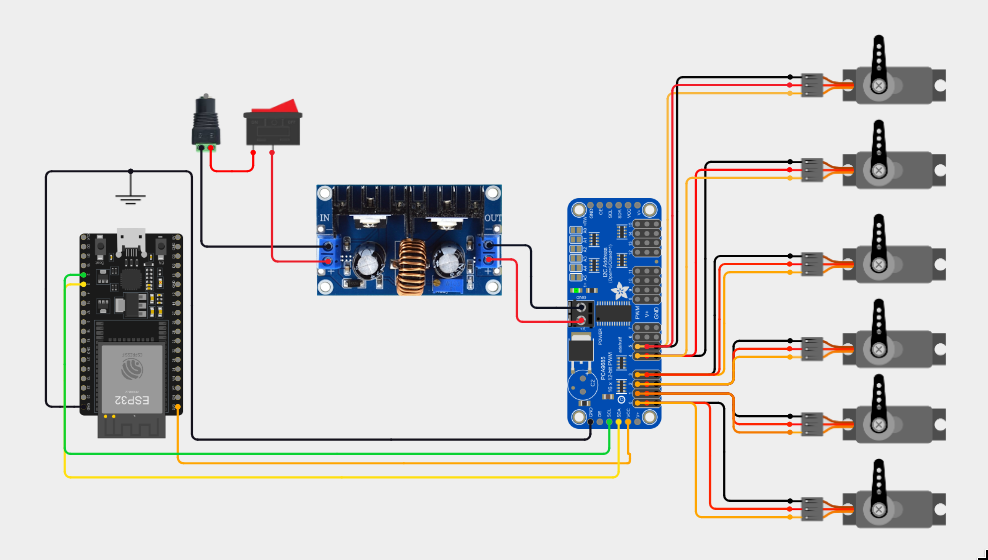
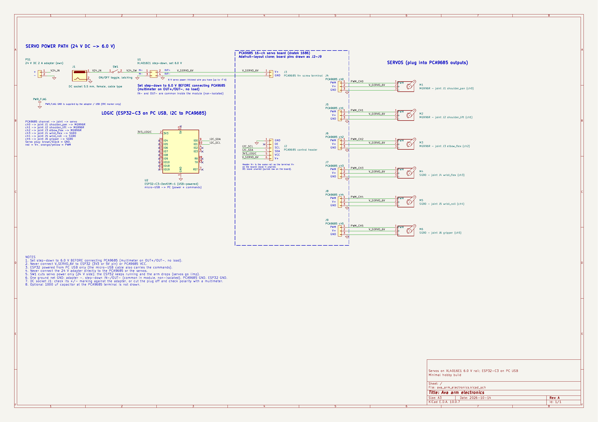

# ava-arm

[](https://github.com/TomasSirotek/ava-arm/actions/workflows/ci.yml)
[](https://github.com/TomasSirotek/ava-dashboard/actions/workflows/ci.yml)

A small 6-DOF desktop arm running ROS 2 Jazzy. In-house Fusion 360 design with 3× MG996R
(shoulder pan, shoulder lift, elbow) and 3× SG90 (wrist flex, wrist roll, gripper).

> **Status:** runs in RViz, Gazebo, MoveIt, the web dashboard and on the real servo board
> (wrist and gripper servos tested). The CAD is still changing. See [CHANGELOG.md](CHANGELOG.md).

## Model files are not in the repo

The CAD export, the URDF/xacro generated from it, the meshes and the STL/STEP files are
git-ignored, so a fresh clone will not launch the robot. See
[ava_description](ros2_ws/src/ava_description/README.md).

## Layout

| Path | What |
|---|---|
| `ros2_ws/src/ava_description` | URDF/xacro, meshes. Depends on nothing. |
| `ros2_ws/src/ava_control` | Gamepad teleop nodes. |
| `ros2_ws/src/ava_moveit_config` | MoveIt 2 config. |
| `ros2_ws/src/ava_vision` | ArUco perception. |
| `ros2_ws/src/ava_bringup` | Top-level launch (stub). |
| `ros2_ws/src/ava_hardware` | ros2_control plugin for the real arm (ESP32 + PCA9685 over USB serial). |
| `LICENSES/` | Third-party license texts (see [ATTRIBUTION.md](ATTRIBUTION.md)). |
| `dashboard/` | Web dashboard (git submodule, [ava-dashboard](https://github.com/TomasSirotek/ava-dashboard)). |
| `firmware/` | ESP32-C3 servo driver (PlatformIO): serial protocol v1 → PCA9685 pulses, with PC unit tests. |
| `hardware/` | Bill of materials (`bom.md`), wiring diagram and schematic. |
| `tools/` | Torque monitor and helper scripts. |
| `tests/` | Repo-level checks that the configs of all packages agree (pytest, no ROS needed). |

## Clone and build

```bash
git clone --recurse-submodules git@github.com:TomasSirotek/ava-arm.git
# already cloned without submodules: git submodule update --init
cd ava-arm/ros2_ws
source /opt/ros/jazzy/setup.bash
colcon build --symlink-install
```

## Run

Use a normal terminal, not VS Code's integrated one (the VS Code snap breaks RViz/Gazebo).
Source both setups first: `source /opt/ros/jazzy/setup.bash && source ros2_ws/install/setup.bash`.

| What | Command |
|---|---|
| Model + sliders in RViz | `ros2 launch ava_description display.launch.py` |
| Gazebo + MoveIt + RViz | `QT_QPA_PLATFORM=xcb ros2 launch ava_moveit_config gazebo_moveit.launch.py rviz_use_sim_time:=true` |
| Bridge for the dashboard (needs `ros-jazzy-rosbridge-suite`) | `ros2 launch rosbridge_server rosbridge_websocket_launch.xml address:=127.0.0.1` |
| Dashboard | `cd dashboard && pnpm dev` |
| Real arm (ESP32 + PCA9685 connected) | `ros2 launch ava_hardware real_robot.launch.py serial_port:=/dev/ttyUSB0 use_rviz:=false` |

### Real arm, step by step

Needs the firmware on the ESP32-C3 (see [its README](firmware/ava_servo_driver/README.md)), the wiring
below, and your user in the `dialout` group. Run each command in its own terminal with both setups sourced.

1. Servo power off. Place the arm by hand in its rest pose (all joints 0°, `ava.control.xacro`).
2. Plug the ESP32-C3 into the PC over USB and find its port: `ls /dev/serial/by-id/` (usually `/dev/ttyUSB0`).
3. Switch servo power on. The servos stay off until the driver starts.
4. Start the arm, either alone or with MoveIt and RViz:

   ```bash
   ros2 launch ava_hardware real_robot.launch.py serial_port:=/dev/ttyUSB0 use_rviz:=false
   ros2 launch ava_moveit_config real_moveit.launch.py serial_port:=/dev/ttyUSB0 use_rviz:=true
   ```

   Wait for `Servo board on /dev/ttyUSB0 answered (protocol 1, 6 channels)`. The arm then moves at full
   servo speed to its rest pose.
5. Optional dashboard:

   ```bash
   ros2 launch rosbridge_server rosbridge_websocket_launch.xml address:=127.0.0.1
   cd dashboard && pnpm dev    # http://localhost:5173
   ```

   The Link tab shows Connected, and the toolbar shows `Joint angles: cmd`.
6. Stop: Ctrl+C in the arm's terminal parks it in the rest pose (about 2 s), then switch servo power off.

The dashboard's emergency stop holds the arm where it is. To cut power at once, switch servo power off:
the servos go limp and the arm drops.

## Wiring



A 24 V adapter feeds the servos through an ON/OFF switch and a step-down set to 6.0 V. The ESP32-C3
runs on USB and drives the PCA9685 over I2C. The diagram shows a generic ESP32 board; use the pins below.

| From | To |
|---|---|
| Adapter + → ON/OFF switch | Step-down IN+ |
| Adapter − | Step-down IN− |
| Step-down OUT+ / OUT− (6.0 V) | PCA9685 screw terminal V+ / GND |
| ESP32-C3 3V3 | PCA9685 VCC |
| ESP32-C3 GND | PCA9685 GND |
| ESP32-C3 IO0 | PCA9685 SDA |
| ESP32-C3 IO1 | PCA9685 SCL |

| PCA9685 channel | 0 | 1 | 2 | 3 | 4 | 5 |
|---|---|---|---|---|---|---|
| Joint | shoulder_pan | shoulder_lift | elbow_flex | wrist_flex | wrist_roll | gripper |
| Servo | MG996R | MG996R | MG996R | SG90 | SG90 | SG90 |

- Set the step-down to 6.0 V with a multimeter before connecting the PCA9685.
- The switch cuts servo power only; the arm goes limp when it is off.
- Servo plugs: brown/black on GND, red on V+, orange/yellow on PWM.

KiCad schematic:



## Tests and CI

Config checks (no ROS needed):

```bash
pip install -r tests/requirements.txt
python3 -m pytest tests
```

Firmware unit tests (on the PC, no board needed):

```bash
cd firmware/ava_servo_driver
pip install -r requirements.txt
pio test -e native
```

GitHub Actions runs the config tests, the dashboard unit tests against this repo, and the firmware
tests plus an ESP32-C3 build. Dependabot keeps the dashboard submodule, actions and PlatformIO current.

## Security

- Meant for one machine: set `export ROS_AUTOMATIC_DISCOVERY_RANGE=LOCALHOST` in `~/.bashrc`.
- Bind rosbridge to `127.0.0.1`; never expose port 9090 or ROS traffic to a network (no authentication).
- Software stops are not an emergency stop: keep the power switch within reach when hardware is connected.

## License

Copyright 2026 Tomas Sirotek. Licensed under the [Apache License 2.0](LICENSE), except where a file
or package states otherwise (`ava_description` is MIT). Upstream sources and their licenses:
[ATTRIBUTION.md](ATTRIBUTION.md), texts in [LICENSES/](LICENSES/).
