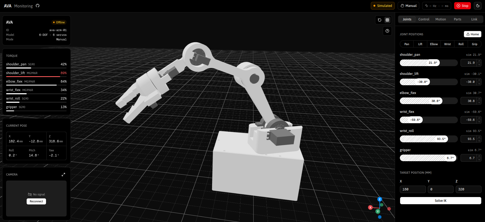

# ava-arm

A small 6-DOF desktop arm running ROS 2 Jazzy, built in Gazebo first and on hardware
second.

The arm started on an off-the-shelf SO-101 model. That model failed the Gazebo load
test — the weight and the payload sit at the end of the arm, so the shoulder and elbow
wanted bigger and more expensive servos than the budget allowed, and shortening the
links barely helped. So the arm was **redrawn from scratch in Fusion 360** (with help
from a Fusion designer) around a fixed servo budget: **2× MG996R** carrying the arm and
the load, **4× SG90** from the elbow out.

> **Status:** the new model runs in RViz, Gazebo and MoveIt, and the web dashboard shows
> and drives it live. Current stage: **testing whether the 2× MG996R + 4× SG90 layout
> actually holds** under load in simulation. No hardware connected yet. See
> [CHANGELOG.md](CHANGELOG.md).

<p align="center"></p>


## The arm model files are supplied locally

The model is kept outside the repo, so these files are git-ignored:

| Not committed | What it is |
|---|---|
| `ava_description/urdf/ava_robotic_arm.urdf` | the Fusion 360 export |
| `ava_description/urdf/ava.kinematics.xacro` | generated from the export |
| `ava_description/urdf/ava.urdf` | generated from the xacro |
| `ava_description/meshes/*.stl` | the part meshes |
| `hardware/stl/`, `hardware/step/` | printable and CAD exports |

The two generated files are excluded alongside the export, because they carry the same
geometry.

Everything else is tracked, including all the hand-written xacro (`ava.urdf.xacro`,
`ava.common.xacro`, `ava.control.xacro`, `ava.ros2control.xacro`, `ava.gazebo.xacro`).
**A fresh clone will not launch the robot** until the model files are dropped in and
regenerated — see [ava_description](ros2_ws/src/ava_description/README.md).

## Layout

| Path | What |
|---|---|
| `ros2_ws/src/ava_description` | URDF/xacro, meshes. Depends on nothing. |
| `ros2_ws/src/ava_control` | Control nodes: gamepad teleop, hardware bridges. |
| `ros2_ws/src/ava_moveit_config` | MoveIt 2 config. |
| `ros2_ws/src/ava_vision` | ArUco perception. |
| `ros2_ws/src/ava_bringup` | Top-level launch (stub). |
| `LICENSES/` | Third-party license texts (see [ATTRIBUTION.md](ATTRIBUTION.md)). |
| `dashboard/` | Web dashboard (git submodule, [ava-dashboard](https://github.com/TomasSirotek/ava-dashboard)). |
| `firmware/` | Microcontroller servo driver. |
| `hardware/` | BOM, STEP/STL, electronics. |
| `docs/` | Design notes and decision records. |
| `tools/` | Offline scripts (URDF diff, mesh measurement, torque monitor). |

Dependency direction: bringup -> control -> kinematics -> nothing.

## Clone

The dashboard is a submodule, so clone with `--recurse-submodules`:

```bash
git clone --recurse-submodules git@github.com:TomasSirotek/ava-arm.git
```

Already cloned without it:

```bash
git submodule update --init
```

Pull the latest of both:

```bash
git pull --recurse-submodules
```

## Build

```bash
cd ros2_ws
source /opt/ros/jazzy/setup.bash
colcon build --symlink-install
```

## Run

Use a normal terminal, not VS Code's integrated one (the VS Code snap breaks RViz/Gazebo).
Source both setups first: `source /opt/ros/jazzy/setup.bash && source ros2_ws/install/setup.bash`.

| What | Command | Details |
|---|---|---|
| Model + sliders in RViz | `ros2 launch ava_description display.launch.py` | [ava_description](ros2_ws/src/ava_description/README.md) |
| Gazebo + MoveIt + RViz | `QT_QPA_PLATFORM=xcb ros2 launch ava_moveit_config gazebo_moveit.launch.py rviz_use_sim_time:=true` | [ava_moveit_config](ros2_ws/src/ava_moveit_config/README.md) |
| Bridge for the dashboard | `ros2 launch rosbridge_server rosbridge_websocket_launch.xml` | needs `ros-jazzy-rosbridge-suite` |
| Dashboard | `cd dashboard && pnpm dev` | [dashboard](dashboard/README.md) |
| Torque check under load | `ros2 launch ava_description gazebo.launch.py payload_kg:=0.1` then `python3 tools/torque_monitor.py` | the current load test |

## License

Upstream sources and their licenses: [ATTRIBUTION.md](ATTRIBUTION.md), texts in [LICENSES/](LICENSES/).
