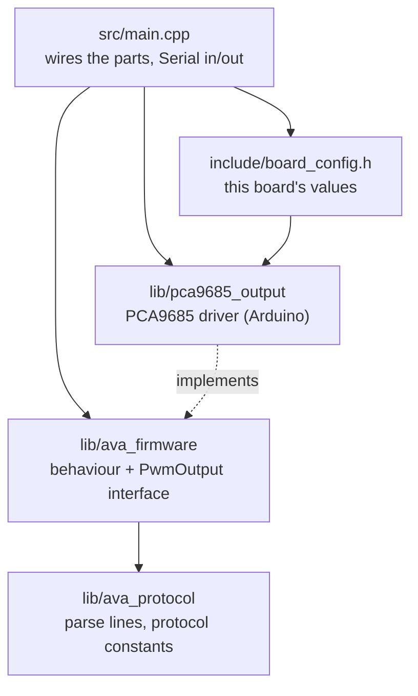

# ava_servo_driver: ESP32-C3 firmware

Puts the pulse widths the ROS driver sends over USB serial onto the PCA9685's servo channels.
No calibration or motion logic lives here: the ROS driver (`ava_hardware`) converts joint angles
to microseconds, clamps them and limits the speed. The firmware only knows channels and
microseconds, so it does not care whether a channel has an SG90 or an MG996R.

## Where it sits

```
PC (ROS 2)                         ESP32-C3-DevKitM-1            PCA9685            servos
ava_hardware/AvaServoSystem  --USB serial-->  this firmware  --I2C-->  16-ch PWM  --PWM--> ch 0-5
(joint angles -> pulse widths)     115200 8N1, text lines         0x40, 50 Hz
```

The ROS driver (`ros2_ws/src/ava_hardware`) already turns joint angles into pulse widths in
microseconds and clamps them; the firmware only has to put those pulses on the right PCA9685
channels. The servos report nothing back, so there is nothing to read from them.

## Wiring

| ESP32-C3 | PCA9685 |
|---|---|
| GPIO0 | SDA |
| GPIO1 | SCL |
| 3V3 | VCC (logic) |
| GND | GND |

The servos get 6.0 V from the step-down converter into the PCA9685 **V+** screw terminal, never
from the ESP32 or USB. The ESP32 is powered by the USB cable only. Channel = joint:

| PCA9685 channel | Joint | Servo |
|---|---|---|
| 0 | J1 shoulder_pan | MG996R |
| 1 | J2 shoulder_lift | MG996R |
| 2 | J3 elbow_flex | MG996R |
| 3 | J4 wrist_flex | SG90 |
| 4 | J5 wrist_roll | SG90 |
| 5 | J6 gripper | SG90 |

## The serial protocol the ROS driver speaks (v1)

USB serial at **115200 baud**, ASCII lines ending in `\n` (ignore `\r`). The driver's settings
are in `ros2_ws/src/ava_description/urdf/ava.urdf.xacro` (`serial_port`, default
`/dev/ttyUSB0`, `baud_rate`) and `ava.control.xacro`.

| PC sends | Firmware does | Firmware replies |
|---|---|---|
| `?` | nothing else | `AVA_SERVO 1 6` (protocol version 1, 6 channels) |
| `P u0 u1 u2 u3 u4 u5` | sets the pulse of channels 0..5, in microseconds; `0` = channel off (no pulse) | nothing |
| `D` | switches all channels off (servos go limp) | nothing |
| anything else | ignores it | `ERR <short reason>` (the driver logs it as a warning) |

Behaviour the driver relies on:

- **At boot all channels are off** and the firmware prints `AVA_SERVO 1 6 READY` once.
- **Handshake:** opening the port resets the ESP32, so the driver keeps sending `?` every 250 ms
  for up to 4 s (`servo_handshake_timeout_ms`) until either reply line arrives. No reply means
  "Is the ESP32 connected to this port and flashed with the Ava servo firmware?".
- **The last `P` pulses are held** until the next `P`, a `D` or power-off. The driver only sends
  `P` when a pulse changes, so the firmware must not time out and switch off on its own.
- **If the board restarts** while running (USB glitch, brown-out) it prints the `READY` line again;
  the driver then re-sends the last pulses.
- **Pulse range:** the driver sends 500–2500 µs (or 0); clamping again on the firmware side is a
  good safety net.

## Code structure

One PlatformIO library per module in `lib/`. Each module has its headers in a folder with its own
name, so includes say where things come from (`#include "ava_protocol/parser.h"`), and each module
keeps its own config next to its code. Dependencies only point downwards:



```
ava_servo_driver/
├── platformio.ini                    board env (esp32c3) + PC test env (native)
├── include/board_config.h            this board: baud, I2C pins GPIO0/1, PCA9685 0x40, 50 Hz, oscillator
├── src/main.cpp                      the only place the parts are created and connected
├── lib/
│   ├── ava_protocol/                 plain C++: protocol v1 text -> commands
│   │   └── src/ava_protocol/
│   │       ├── protocol_config.h     version 1, 6 channels, 500-2500 µs clamp, max line length
│   │       ├── command.h             the Command type (Query / SetPulses / Disable / Invalid)
│   │       ├── parser.*              one line -> Command, pulse clamping
│   │       └── line_buffer.*         characters -> lines, ignores \r, flags too-long lines
│   ├── ava_firmware/                 plain C++: what the firmware does
│   │   └── src/ava_firmware/
│   │       ├── pwm_output.h          interface to the PWM hardware (no Arduino types)
│   │       └── servo_firmware.*      boot (all off, READY), replies, pulses, ERR lines
│   └── pca9685_output/               Arduino: PwmOutput on a PCA9685
│       └── src/pca9685_output/
│           ├── pca9685_config.h      Pca9685Config: pins, address, frequency, oscillator
│           └── pca9685_output.*      Adafruit PWM Servo Driver; reports a missing chip
└── test/
    ├── test_protocol/                parser + line buffer
    └── test_firmware/                behaviour against a fake PwmOutput
```

| To change | Edit |
|---|---|
| ESP32 pins, PCA9685 address, oscillator calibration, baud | `include/board_config.h` |
| Number of channels, pulse clamp (must match `ava_hardware`) | `lib/ava_protocol/src/ava_protocol/protocol_config.h` |
| Other PWM hardware | a new class implementing `ava_firmware/pwm_output.h`, created in `src/main.cpp` instead of `Pca9685Output` |
| More than 16 channels | a second `Pca9685Config` (e.g. address 0x41) and a small `PwmOutput` that splits channels across the two boards |
| A new command | `command.h` + `parser.cpp`, then `servo_firmware.cpp`, with tests in both suites |

`ava_protocol` and `ava_firmware` are plain C++ without Arduino, so the tests run on the PC.
If the PCA9685 does not answer at boot, the firmware prints `ERR PCA9685 not found on I2C …` and
answers `?` and `P` with the same error instead of `AVA_SERVO`, so the ROS driver's handshake
fails with a clear reason instead of sending pulses into nothing.

## Build, test, flash

```bash
cd firmware/ava_servo_driver
pio test -e native            # unit tests on the PC, no board needed
pio run -e esp32c3            # build
pio run -e esp32c3 -t upload  # flash (close any serial monitor and the ROS launch first)
pio device monitor --echo     # talk to it by hand at 115200
```

## Bring-up

1. Wiring as above, servos unplugged. PCA9685 V+ from the servo supply, **measured first**:
   5 V for SG90-only tests, 6.0 V (XL4016) once MG996Rs are connected. Never above 6.0 V.
2. Flash, open the monitor, press RESET: `AVA_SERVO 1 6 READY`. An `ERR PCA9685 not found` line
   means the I2C wiring (SDA/SCL swapped, VCC or GND missing) or a different address.
3. One servo, horn only: `P 1500 0 0 0 0 0` (channel 0), then `P 1000 0 0 0 0 0`,
   `P 2000 0 0 0 0 0`, then `D`. For another channel move the number: `P 0 0 0 1500 0 0` = ch 3.
4. **Oscillator calibration.** The PCA9685's oscillator is not exactly 25 MHz, so every pulse is
   off by the same factor. With a servo whose real end points you know (e.g. measured directly on
   an ESP32 pin), find the commanded value where it reaches that end through the PCA9685, then set
   `kPca9685OscillatorHz = 25000000 × commanded / true` in `board_config.h`. Example: true end
   2500 µs, reached at `P 2440 …` → 25000000 × 2440 / 2500 = 24400000.
5. Only then the ROS driver (`ros2 launch ava_hardware real_robot.launch.py`, once `ava_hardware`
   is un-parked). Per-joint calibration (centre, direction, range) lives in
   `ros2_ws/src/ava_description/urdf/ava.control.xacro`, not in the firmware.
